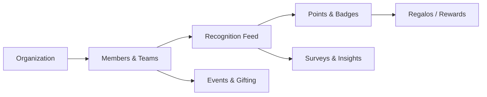

# Overview

**This page explains how the pieces of GiftSpark connect so the rest of the documentation makes sense.** GiftSpark is organized around one simple loop — recognize a teammate, earn points for participating, redeem points for rewards — with surveys, events, and gifting tools built around that loop.

## The core model

1. **Organization** — the top-level container. A company, department, or small team each gets its own organization with its own members, roles, rewards catalog, and budget.
2. **Members & teams** — people join an organization, are grouped into teams and subgroups, and appear in a searchable directory.
3. **Recognition** — members post kudos and thank-yous to the feed, optionally tagged with a company value and points.
4. **Points & gamification** — recognition earns points, badges, and streaks, and moves people up leaderboards.
5. **Rewards (Regalos)** — points are redeemed in the rewards catalog through an approval and order workflow.
6. **Insights & gifting** — surveys, sentiment, and a health score read engagement; events and gifting tools keep teams connected.

## Roles at a glance

GiftSpark uses role-based access so the right people see the right tools:

- **Member** — gives and receives recognition, redeems rewards, joins gifting activities.
- **Manager** — everything a member can do, plus the manager dashboard, team insights, and survey results.
- **Admin / Organization owner** — configures the organization, manages the rewards catalog and budget, approves redemptions, and manages roles.

Roles and the exact permissions behind them are covered in [Setup & roles](../organization/setup-and-roles.md).

## Where GiftSpark runs

| Surface | Notes |
|---|---|
| **Web app** | The full platform at [giftspark.aoneahsan.com](https://giftspark.aoneahsan.com). |
| **Android / iOS** | Native apps via Capacitor, with push notifications and biometric unlock. |
| **Browser extension** | A companion for saving gift ideas and tracking events outside the app. |

Because everything shares one Firebase backend, your recognition, points, and rewards stay in sync across every surface you sign in on.

## Next steps

- [Account setup](account-setup.md) — sign in and join or create your organization.
- [Quick start](quick-start.md) — send your first recognition and redeem your first reward.
